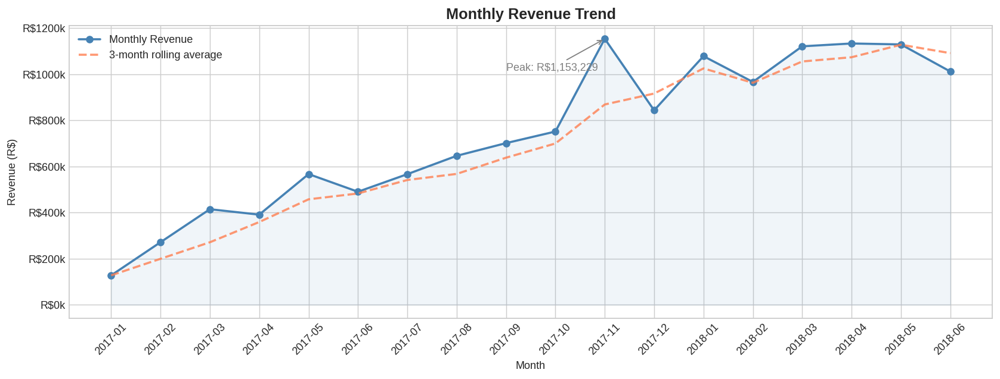
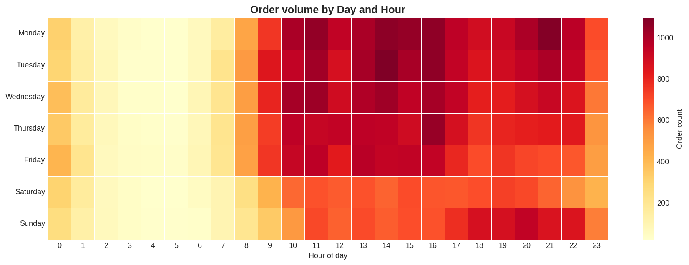
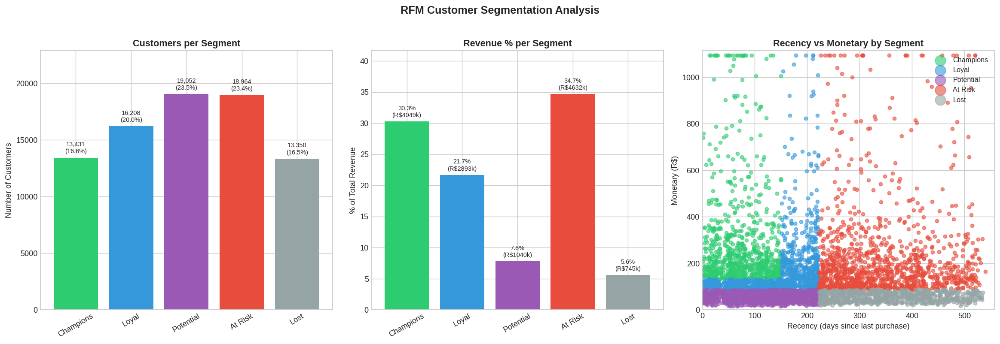
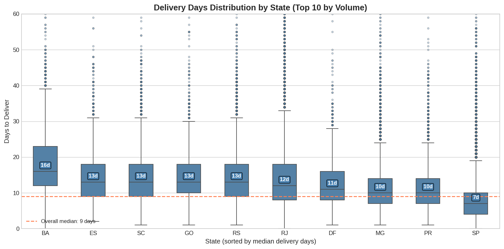

# Olist E-Commerce Sales Analysis

End-to-end analytics project on the [Olist Brazilian E-Commerce dataset](https://www.kaggle.com/datasets/olistbr/brazilian-ecommerce) (Kaggle) covering data cleaning, exploratory data analysis across six business dimensions, RFM customer segmentation, and ten SQL queries using advanced window functions and CTEs.


---

## Key Findings

| Metric | Value | Insight |
|--------|-------|---------|
| Revenue Peak | R$1,153,229 | Nov 2017 — Black Friday (+53.5% MoM) |
| Customer Growth | +728% | New customers Jan 2017 → Jul 2018 |
| Repeat Buyers | 3% of customers | 1.9× higher LTV (R$307 vs R$161) |
| Avg Review Score | 4.16★ | Delivery time is #1 driver (r = −0.335) |
| Delivery Gap | 18 days | São Paulo 7d vs Amazonas 25d |
| At-Risk Revenue | 34.7% | Exceeds Champions segment (30.3%) |

> **Standout finding:** The At-Risk RFM segment — historically high-value customers who have not returned — drives more total revenue (34.7%) than Champions (30.3%). Re-engaging this cohort has higher ROI potential than acquiring new customers.

---

## Visualizations

### Monthly Revenue with Rolling Average


### Day × Hour Order Heatmap


### RFM Segment Distribution


### Delivery Days by State


---

## Repository Structure

```
ecommerce-sales-analysis/
│
├── README.md
├── requirements.txt
│
├── notebooks/
│   ├── 01_Olist_Sales_Cleaned.ipynb      # Cleaning pipeline — joins 7 CSVs into 2 analysis-ready files
│   ├── 02_Olist_Sales_EDA.ipynb          # Six-section EDA with visualizations
│   └── 03_Olist_SQL_Analysis.ipynb       # 10 SQL queries via DuckDB
│
├── clean/                                 # Derived output files (raw Olist CSVs not tracked — see data/)
│   ├── master_orders.csv                  # 96,469 delivered orders × 24 columns
│   ├── master_products.csv                # 112,650 rows × 13 columns (item-level grain)
│   ├── reviews_text_clean.csv
│   └── rfm_segments.csv                   # RM-scored customer segments
│
├── images/                                # Chart exports from EDA notebook
│   ├── monthly_revenue.png
│   ├── order_heatmap.png
│   ├── rfm_segments.png
│   └── delivery_by_state.png
│
└── data/
    └── README.md                          # Instructions to download raw Olist CSVs from Kaggle
```

---

## Notebooks

### 01 · Data Cleaning

Joins seven Olist CSV files into two analysis-ready dataframes.

**Key decisions:**
- Filter to `delivered` orders only — 96,469 rows
- Use `customer_unique_id` (not `customer_id`) for person-level identity
- Resolve 764 duplicate review IDs across different orders (drop all)
- Resolve 543 duplicate order submissions (keep latest)
- Fill null product categories with `'unknown'` — product still has real sales data

### 02 · Exploratory Data Analysis

| Section | Topic | Highlight |
|---------|-------|-----------|
| 1 | Revenue & Time | Volume-driven growth; AOV stable at R$146–170 throughout |
| 2 | Products | `health_beauty` #1 revenue; `watches_gifts` 94% AOV premium |
| 3 | Customers | 97% one-time buyers; Black Friday cohort had worst retention |
| 4 | Geography | São Paulo = 37% revenue; remote states spend more per order |
| 5 | RFM Segmentation | At-Risk holds most revenue (34.7%) — highest of any segment |
| 6 | Reviews | 10.7-day delivery gap between 1★ and 5★; Champions rate lowest |

### 03 · SQL Analysis (DuckDB)

Ten queries executed in-notebook against the cleaned CSVs — no external database needed.

| # | Query | SQL Concepts |
|---|-------|--------------|
| Q1 | Monthly revenue + MoM growth | CTE, `LAG()` |
| Q2 | Rolling 3-month average | `AVG() OVER (ROWS BETWEEN 2 PRECEDING AND CURRENT ROW)` |
| Q3 | Quarterly revenue + QoQ growth | `PARTITION BY`, `CASE WHEN`, % of year |
| Q4 | Top 10 customers by LTV | `RANK()` on two dimensions, `DATEDIFF`, `SUM() OVER ()` |
| Q5 | Repeat vs one-time revenue split | 3 chained CTEs, window-function percentages |
| Q6 | Days between 1st and 2nd purchase | `ROW_NUMBER() OVER PARTITION BY`, distribution buckets |
| Q7 | Revenue rank within category | `RANK()` + `DENSE_RANK()`, nested windows |
| Q8 | Late delivery rate by category | `COUNT(DISTINCT CASE WHEN …)` to handle join fan-out |
| Q9 | Delivery days by state vs national avg | `CROSS JOIN` benchmark CTE, `STDDEV()`, 3× `RANK()` |
| Q10 | New customer acquisition per month | `QUALIFY ROW_NUMBER()`, cumulative `SUM() OVER (ROWS UNBOUNDED)` |

---

## How to Run

All notebooks run on **Google Colab** — no local setup required.

**Step 1 — Get the raw data**

Download the [Olist dataset from Kaggle](https://www.kaggle.com/datasets/olistbr/brazilian-ecommerce) and upload the CSVs to your Colab session (or mount Google Drive).

**Step 2 — Install DuckDB**

```python
!pip install duckdb
```

**Step 3 — Run notebooks in order**

```
01_Olist_Sales_Cleaned.ipynb   →  generates clean/master_orders.csv and master_products.csv
02_Olist_Sales_EDA.ipynb       →  reads from clean/; generates rfm_segments.csv + images/
03_Olist_SQL_Analysis.ipynb    →  reads from clean/; requires duckdb
```

---

## Tech Stack

- **Python 3** — Pandas, NumPy, Matplotlib, Seaborn
- **SQL** — DuckDB (in-notebook, no server)
- **Environment** — Google Colab / Jupyter

---

## Dataset

[Brazilian E-Commerce Public Dataset by Olist](https://www.kaggle.com/datasets/olistbr/brazilian-ecommerce) — Kaggle, CC BY-NC-SA 4.0.

~100k orders placed on the Olist marketplace between 2016 and 2018, including order status, price, payment, freight, customer location, product attributes, and customer reviews.

> **Scope note:** EDA uses `master_orders_stable` (Jan 2017–Jul 2018), excluding the soft-launch period and incomplete final month. SQL queries run on the full dataset (89,851 rows). The 97/3 repeat-buyer split is consistent across both scopes.

---

## Author

**Dev Gupta**  
[LinkedIn](https://linkedin.com/in/YOUR_HANDLE) · [GitHub](https://github.com/YOUR_HANDLE)
